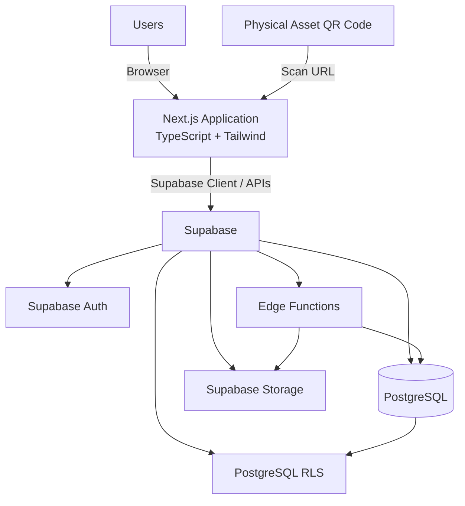
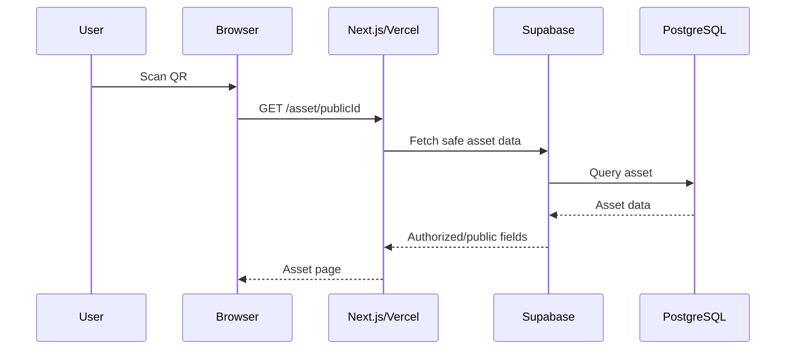
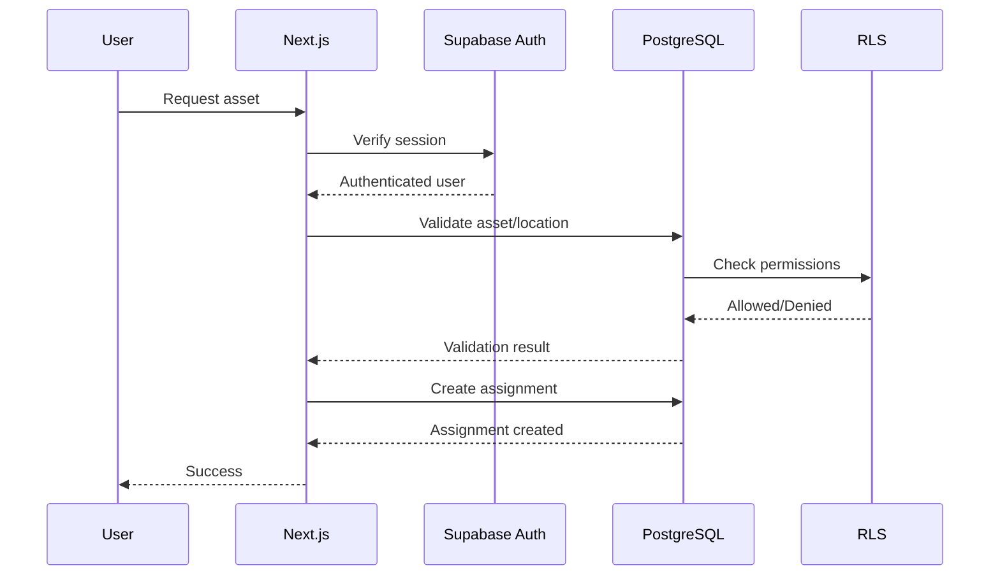
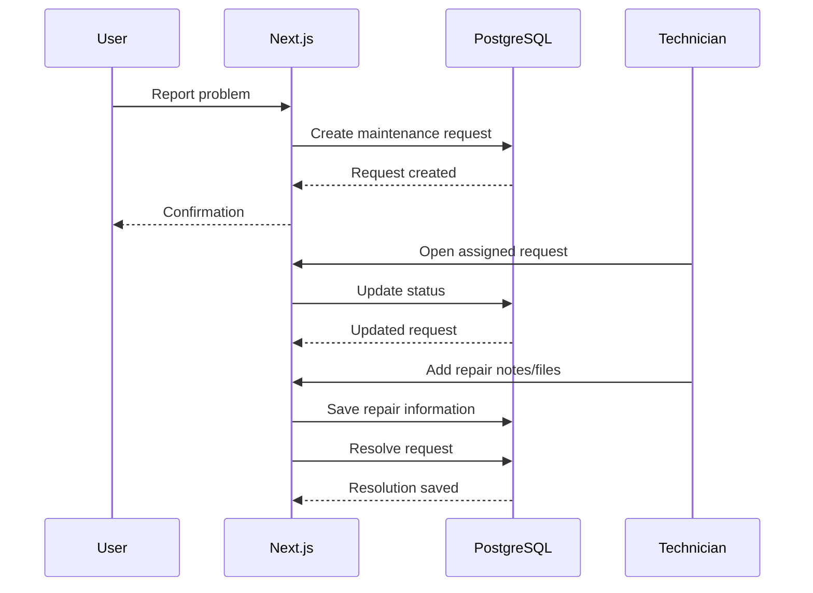

# System Architecture
## Cloud-Based Campus Asset QR & Maintenance Management System

> **Status:** Implementation-ready architecture specification  
> **Audience:** Claude Code / student development team  
> **Source of truth:** `docs/00-project-context.md` and `docs/01-product-requirements.md`

---

# 1. Architecture Goal

The system uses a **serverless, managed-backend web architecture** designed for:

- Low implementation complexity
- High reliability
- Clear cloud-computing concepts
- Free-tier deployment
- Strong security
- Easy local development
- Easy Vercel deployment
- Easy explanation during a PBL/viva

The architecture intentionally avoids a separately managed backend server.

---

# 2. Final Architecture



---

# 3. Architecture Layers

Use four logical layers.

## Layer 1 — Physical / QR Layer

This represents the physical campus environment.

```text
Projector
Laptop
Arduino Kit
Camera
Oscilloscope
       ↓
QR sticker
```

The QR provides a stable public identifier/URL for the physical asset.

---

## Layer 2 — Presentation/Application Layer

Implemented using:

- Next.js
- React
- TypeScript
- Tailwind CSS

Hosted on Vercel.

Responsibilities:

- Render UI
- Handle navigation
- Collect user input
- Display asset information
- Display dashboards
- Perform client-side UX validation
- Call Supabase services
- Invoke authorized server-side operations where required

---

## Layer 3 — Managed Backend Layer

Supabase provides:

- PostgreSQL
- Auth
- APIs
- RLS
- Storage
- Edge Functions

This is the project's Backend-as-a-Service layer.

---

## Layer 4 — Data and Security Layer

PostgreSQL contains structured application data.

RLS enforces row-level authorization.

Storage contains files.

Auth establishes user identity.

Edge Functions provide custom serverless logic.

---

# 4. Request Flow

A typical browser request follows:

```text
User
 ↓
Next.js / Vercel
 ↓
Supabase client/API
 ↓
Supabase service
 ↓
PostgreSQL / Auth / Storage
 ↓
Response
 ↓
Next.js UI
```

For custom server-side logic:

```text
User
 ↓
Next.js
 ↓
Edge Function
 ↓
Validation / business logic
 ↓
Supabase
 ↓
Database / Storage
 ↓
Response
```

---

# 5. Why There Is No Traditional Express Backend

Do not introduce a separate Express/Node backend.

A traditional design would be:

```text
Next.js
   ↓
Express API
   ↓
PostgreSQL
```

This would require:

- Backend server deployment
- API routing
- Server maintenance
- Scaling configuration
- Database connection management
- Additional infrastructure

The project already has a managed backend through Supabase.

Use:

```text
Next.js
   ↓
Supabase APIs
   ↓
PostgreSQL
```

and only use custom server-side/Edge Function logic when necessary.

---

# 6. Next.js Responsibilities

Next.js is the application framework.

It handles:

- Routes
- Pages
- Layouts
- UI
- Server-side functionality where useful
- Client components where interaction is required
- Form handling
- Data presentation
- Authentication-aware rendering

Suggested application routes are documented in `01-product-requirements.md`.

---

# 7. Vercel Responsibilities

Vercel hosts the Next.js application.

It provides:

- Production deployment
- HTTPS
- CDN/distribution
- Build system
- Environment variables
- Deployment history
- Application logs
- Serverless execution capabilities associated with the Next.js deployment model

Do not use Vercel as the primary database or file store.

---

# 8. Supabase Responsibilities

Supabase is the primary backend platform.

It provides:

```text
PostgreSQL
Auth
RLS
Storage
APIs
Edge Functions
```

Each service has a distinct responsibility.

---

# 9. PostgreSQL Responsibilities

PostgreSQL stores:

- Profiles
- Buildings
- Rooms
- Assets
- Asset assignments
- Maintenance requests
- Maintenance history
- Asset documents metadata
- Notifications if implemented
- Audit logs

PostgreSQL is the source of truth for structured application data.

---

# 10. Authentication Architecture

Use Supabase Auth.

Authentication flow:

```text
User
 ↓
Login form
 ↓
Supabase Auth
 ↓
Authenticated session
 ↓
Application reads user identity
 ↓
Profile/role is resolved
 ↓
Authorized UI
```

The client must never decide that a user is an admin simply because a client-side value says so.

The authoritative authorization model must be backed by database/RLS rules.

---

# 11. Authorization Architecture

Use layered authorization:

```text
Layer 1:
Route protection

Layer 2:
UI permission checks

Layer 3:
Server-side validation

Layer 4:
PostgreSQL RLS
```

RLS is the final database security boundary.

Examples:

```text
Public
  → public asset fields

Student/Staff
  → own requests/assignments

Technician
  → authorized maintenance records

Admin
  → administrative records
```

Exact policies belong in `04-rls-security-policies.md`.

---

# 12. QR Architecture

Each asset receives a stable public identifier.

Example:

```text
AST-2026-00142
```

QR:

```text
https://app.example.com/asset/AST-2026-00142
```

The QR does not store:

- Asset serial number
- User identity
- Password
- Maintenance notes
- Private storage paths
- Authentication information

The QR is simply a pointer to the public asset route.

---

# 13. QR Request Flow



The scan itself does not modify the database.

---

# 14. Asset Usage Architecture

An asset has a registered location:

```text
registered_building_id
registered_room_id
```

An assignment/request has its own usage location:

```text
usage_building_id
usage_room_id
```

Example:

```text
Asset:
Projector P-104

Registered:
Vyas → VY001

Current use:
Vivekananda → VK404
```

This is essential.

Never overwrite the registered location when the asset is temporarily used elsewhere.

---

# 15. Building → Room Data Flow

The frontend requests buildings.

Example:

```text
GET buildings
```

User selects:

```text
Vyas
```

The frontend requests/filter rooms belonging to that building.

Conceptually:

```text
selectedBuildingId
        ↓
rooms where building_id = selectedBuildingId
```

The UI then displays:

```text
VY001
VY101
VY201
```

When the building changes:

```text
Vivekananda
```

the room selection is reset and the new room set is loaded.

The backend/database must independently validate:

```text
room.building_id == selectedBuildingId
```

---

# 16. Asset Request / Assignment Flow



The assignment must include usage location.

---

# 17. Maintenance Architecture

Maintenance is a separate operational workflow.

```text
Asset
 ↓
Problem Report
 ↓
Maintenance Request
 ↓
Technician Assignment
 ↓
Work
 ↓
Resolution
 ↓
Maintenance History
```

A maintenance request references the asset.

The request has its own status and priority.

Maintenance history should preserve completed repair information rather than relying only on the current request row.

---

# 18. Maintenance Request Flow



---

# 19. Storage Architecture

Use Supabase Storage for files.

```text
Supabase Storage
│
├── asset-images
│
├── maintenance-images
│
└── maintenance-documents
```

Database records should store references/metadata rather than large binary content.

Private files must not be exposed through public buckets.

---

# 20. Storage Access Flow

```text
Authenticated User
       ↓
Application
       ↓
Permission check
       ↓
Supabase Storage
       ↓
Authorized file access
```

For private files, use authorized access/signed URLs where appropriate.

---

# 21. Edge Function Architecture

Edge Functions are custom serverless backend logic.

Use them selectively.

Example:

```text
Maintenance request
       ↓
Edge Function
       ↓
Validate/process workflow
       ↓
Database update
       ↓
Optional notification
```

Potential functions:

```text
notify-maintenance-assignment
process-warranty-reminders
process-maintenance-reminders
```

Do not create functions for basic CRUD unless a real security/business requirement exists.

---

# 22. Edge Function Invocation Model

Functions may be triggered by:

- Authenticated application request
- Scheduled invocation/workflow where supported
- Other controlled server-side events

Do not expose privileged function operations to anonymous users.

Any function receiving user input must validate:

- Authentication
- Authorization
- Input shape
- Entity existence
- Entity relationships
- Allowed state transitions

---

# 23. Data Access Strategy

Use the simplest secure mechanism for each operation.

## Direct Supabase client/API

Suitable for:

- Public asset reads
- User's permitted reads
- Standard CRUD protected by RLS
- Simple building/room queries

## Next.js server-side logic

Suitable for:

- Server-only processing
- Operations requiring server-side secrets
- Complex form handling where appropriate
- Secure orchestration

## Edge Functions

Suitable for:

- Reusable custom serverless workflows
- Privileged operations
- Notifications/reminders
- Background/custom processing

Do not automatically route every request through an Edge Function.

---

# 24. Data Security Boundary

The security boundary is:

```text
Browser
   ↓
Untrusted input
   ↓
Application validation
   ↓
Supabase
   ↓
RLS
   ↓
PostgreSQL
```

Never assume browser validation is sufficient.

---

# 25. Client vs Server Code

Use client components only where browser interaction is required.

Examples:

- Dependent dropdowns
- Interactive forms
- Modals
- Toasts
- QR download interactions
- Dynamic filters

Use server-side logic where it improves security or data handling.

Never expose:

- Service-role keys
- Private credentials
- Sensitive administrative secrets

to client-side JavaScript.

---

# 26. Database Query Principles

Queries must be:

- Explicit
- Limited to needed fields
- Paginated where lists can grow
- Indexed appropriately
- Protected by RLS
- Error handled

Avoid:

```text
SELECT everything from every table
```

for normal UI pages.

Prefer targeted queries.

---

# 27. Scalability Architecture

The application is designed to scale horizontally at the application layer because application logic is largely stateless.

```text
Users
  ↓
Vercel
  ↓
Supabase
```

Scalability improvements include:

- Pagination
- Indexes
- Efficient queries
- Image optimization
- Avoiding unnecessary client requests
- Stateless application logic

Do not claim unlimited scalability.

Practical limits remain at:

- Database resources
- Storage
- Network egress
- Service quotas
- Query complexity

---

# 28. Monitoring Architecture

Monitor:

## Vercel

- Deployment success/failure
- Build errors
- Runtime/application errors
- Deployment history

## Supabase

- Database issues
- Authentication activity/errors
- Storage usage/issues
- Edge Function logs
- Database/API activity

The project should demonstrate these during the PBL presentation.

---

# 29. Failure Handling

The application must handle failures gracefully.

Examples:

```text
Database unavailable
→ Show temporary service error

Asset not found
→ Show 404-style asset page

Unauthorized
→ Show permission error / redirect to login

Storage upload fails
→ Keep form state where practical and show upload error

Edge Function fails
→ Log error and show controlled failure message
```

Never expose:

- Stack traces
- Database credentials
- Service-role keys
- Internal implementation secrets

---

# 30. Backup and Recovery Architecture

The database is a managed Supabase PostgreSQL resource.

Use the available Supabase backup/recovery capabilities appropriate to the selected plan.

Application design should reduce destructive operations by preferring:

```text
Archive / Retire
```

over permanent deletion for important asset records.

Files require a separate storage recovery/backup strategy.

The implementation documentation must distinguish:

- Database recovery
- File recovery
- Application redeployment

---

# 31. Deployment Architecture

Development:

```text
Developer machine
      ↓
Git
      ↓
GitHub
```

Deployment:

```text
GitHub
   ↓
Vercel
   ↓
Production Next.js application
```

Backend:

```text
Supabase project
   ├── Database
   ├── Auth
   ├── Storage
   └── Edge Functions
```

The application must be deployable without manually modifying source code for production.

Use environment variables.

---

# 32. Environment Architecture

Local:

```text
.env.local
```

Production:

```text
Vercel Environment Variables
```

Public configuration may use:

```text
NEXT_PUBLIC_SUPABASE_URL
NEXT_PUBLIC_SUPABASE_ANON_KEY
```

Any server-only secret must not use the `NEXT_PUBLIC_` prefix.

Never commit `.env.local`.

Provide:

```text
.env.example
```

with variable names only.

---

# 33. Free-Tier Architecture

The architecture is intentionally compatible with free-tier services.

Target:

```text
Next.js       → Open source
Tailwind      → Open source
GitHub        → Free
Vercel        → Free tier
Supabase      → Free tier
QR library    → Open source
```

No paid service should be a dependency for MVP functionality.

---

# 34. Architecture Decision Records

## ADR-01: Supabase instead of custom backend

Decision:

Use Supabase as the managed backend platform.

Reason:

- PostgreSQL
- Auth
- RLS
- Storage
- APIs
- Edge Functions
- Lower complexity

---

## ADR-02: Vercel for hosting

Decision:

Use Vercel.

Reason:

- Strong Next.js integration
- Simple deployment
- HTTPS
- Managed infrastructure
- Free-tier suitability

---

## ADR-03: PostgreSQL instead of NoSQL

Decision:

Use PostgreSQL.

Reason:

The domain contains strong relationships:

```text
Users ↔ Assignments ↔ Assets
Assets ↔ Maintenance
Buildings ↔ Rooms
Users ↔ Audit Logs
```

Relational constraints and foreign keys are valuable.

---

## ADR-04: Registered and usage locations are separate

Decision:

Keep asset registered location separate from assignment usage location.

Reason:

An asset can temporarily be used in another building/room without changing where the asset officially belongs.

---

## ADR-05: Building and room are separate entities

Decision:

Store buildings and rooms relationally.

Reason:

- Prevent invalid combinations
- Support dependent dropdown
- Allow future campus changes
- Avoid hardcoded location lists

---

## ADR-06: No GPS for core location workflow

Decision:

Do not use automatic GPS detection.

Reason:

- Indoor GPS accuracy is unreliable
- Requires user permission
- Adds privacy concerns
- User-selected campus rooms are more deterministic
- Not necessary for MVP

---

## ADR-07: No separate Express backend

Decision:

Do not build a standalone backend server.

Reason:

Supabase and Next.js server-side functionality provide the required backend capabilities without unnecessary infrastructure.

---

## ADR-08: Edge Functions only where useful

Decision:

Use a small number of meaningful Edge Functions.

Reason:

Demonstrates serverless computing without creating unnecessary complexity.

---

# 35. End-to-End Architecture Example

Example: projector temporarily used in another building.

```text
Physical Projector P-104
        ↓
QR sticker
        ↓
Phone scans
        ↓
Vercel / Next.js
        ↓
Supabase
        ↓
PostgreSQL finds:
  Projector P-104
  Registered = Vyas / VY001
        ↓
User logs in
        ↓
Request Asset
        ↓
Building = Vivekananda
        ↓
Rooms = VK301, VK404, ...
        ↓
Room = VK404
        ↓
Backend validates:
  VK404 belongs to Vivekananda
        ↓
Assignment created
        ↓
Usage location = Vivekananda / VK404
        ↓
Asset status = ASSIGNED
```

Registered location remains:

```text
Vyas / VY001
```

---

# 36. What Claude Code Must Implement

Claude Code is responsible for application implementation.

It must create:

- Next.js project structure
- TypeScript types
- Pages/routes
- Components
- Forms
- Supabase client integration
- Server-side integration where required
- Database migration SQL
- RLS policy SQL
- Storage integration
- QR generation
- Assignment workflow
- Maintenance workflow
- Audit logging integration
- Edge Function source code
- Validation
- Error handling
- Tests
- `.env.example`
- Documentation updates where needed

Claude Code must not silently omit backend integration because Supabase is managed.

---

# 37. What the Human Developer Must Prepare

The human developer will handle Supabase project preparation.

Claude Code should provide instructions/scripts/configuration for:

- Creating the Supabase project
- Applying migrations
- Configuring Auth
- Configuring Storage buckets
- Deploying Edge Functions
- Adding environment variables
- Verifying RLS

Claude Code should not assume that a Supabase project already contains tables, buckets, users, policies or functions unless the developer has confirmed that they do.

---

# 38. Architecture Success Criteria

The architecture is successful when:

1. A QR code can identify an asset.
2. The asset page can retrieve safe information from Supabase.
3. Authentication works through Supabase Auth.
4. RLS prevents unauthorized database access.
5. Admins can manage assets.
6. Buildings and rooms are relationally connected.
7. Usage location is separate from registered location.
8. Asset requests create assignment records.
9. Maintenance requests can be processed.
10. Files can be stored securely.
11. Important operations are audited.
12. At least one meaningful Edge Function exists.
13. The application deploys to Vercel.
14. The entire MVP works without paid infrastructure.
