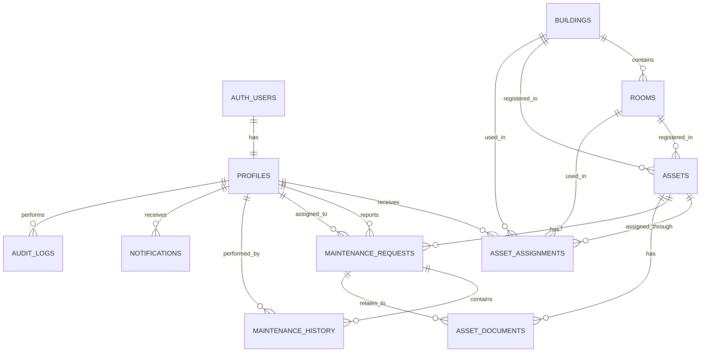

# Database Schema
## Cloud-Based Campus Asset QR & Maintenance Management System

> **Status:** Implementation-ready database specification  
> **Audience:** Claude Code / student development team  
> **Source of truth:** `docs/00-project-context.md`, `docs/01-product-requirements.md`, `docs/02-system-architecture.md`
>
> **Supabase responsibility boundary:** The human developer will create/prepare the Supabase project. Claude Code must generate the SQL migrations, constraints, indexes, RLS policies, seed data, and application integration required by this schema.

---

# 1. Database Technology

Use:

**Supabase PostgreSQL**

PostgreSQL is the authoritative source of truth for structured application data.

Do not introduce another database.

Do not store core relational data in JSON files, local storage, or an external database.

---

# 2. Design Goals

The database must:

- Represent campus buildings and rooms
- Represent physical assets
- Keep registered asset location separate from temporary usage location
- Track users and roles
- Track assignments and transfers
- Track maintenance requests and history
- Track uploaded documents/images through storage metadata
- Support audit logging
- Support RLS
- Support efficient search/filtering
- Avoid unnecessary normalization
- Preserve historical records
- Prevent invalid relationships

---

# 3. Entity Relationship Diagram



---

# 4. UUID Strategy

Use PostgreSQL UUIDs for internal primary keys where practical.

Example:

```sql
id uuid primary key default gen_random_uuid()
```

Do not expose internal UUIDs unnecessarily in public URLs.

Use a separate stable public asset identifier.

---

# 5. Enumerations

Use PostgreSQL enums or constrained text values for controlled states.

The following logical enums are required.

## User role

```text
ADMIN
TECHNICIAN
STAFF
STUDENT
```

A public user does not require a profile because they are unauthenticated.

If the implementation combines STAFF and STUDENT into one application role, that is acceptable only if it does not weaken permissions.

---

## Asset status

```text
AVAILABLE
ASSIGNED
IN_MAINTENANCE
LOST
DAMAGED
RETIRED
```

---

## Assignment status

Recommended:

```text
ACTIVE
RETURNED
CANCELLED
```

---

## Maintenance status

```text
OPEN
ASSIGNED
IN_PROGRESS
RESOLVED
CANCELLED
```

---

## Maintenance priority

```text
LOW
MEDIUM
HIGH
CRITICAL
```

---

# 6. `profiles`

## Purpose

Stores application-level information associated with a Supabase Auth user.

Supabase Auth remains responsible for authentication identity.

`profiles` stores application-specific profile and role data.

## Columns

| Column | Type | Constraints | Purpose |
|---|---|---|---|
| `id` | uuid | PK, FK to auth.users.id | User identity |
| `full_name` | text | NOT NULL | Display name |
| `email` | text | nullable/unique as appropriate | Application email |
| `role` | user_role | NOT NULL | Application role |
| `department` | text | nullable | Department |
| `phone` | text | nullable | Optional contact |
| `is_active` | boolean | NOT NULL DEFAULT true | Whether account is active |
| `created_at` | timestamptz | NOT NULL DEFAULT now() | Creation time |
| `updated_at` | timestamptz | NOT NULL DEFAULT now() | Last update |

### Constraints

- `id` must reference `auth.users(id)`.
- Role must be a valid enum value.
- Inactive users must not be able to perform normal authenticated operations.

### Notes

Do not duplicate passwords or authentication secrets in this table.

---

# 7. `buildings`

## Purpose

Stores campus buildings.

Examples:

```text
Vyas
Vivekananda
```

## Columns

| Column | Type | Constraints |
|---|---|---|
| `id` | uuid | PK |
| `name` | text | NOT NULL |
| `code` | text | NOT NULL, UNIQUE |
| `description` | text | nullable |
| `is_active` | boolean | NOT NULL DEFAULT true |
| `created_at` | timestamptz | NOT NULL DEFAULT now() |
| `updated_at` | timestamptz | NOT NULL DEFAULT now() |

### Example

```text
id: ...
name: Vyas
code: VY
```

---

# 8. `rooms`

## Purpose

Stores rooms belonging to buildings.

This table enables the dependent Building → Room dropdown.

## Columns

| Column | Type | Constraints |
|---|---|---|
| `id` | uuid | PK |
| `building_id` | uuid | FK to buildings.id, NOT NULL |
| `room_number` | text | NOT NULL |
| `display_name` | text | nullable |
| `is_active` | boolean | NOT NULL DEFAULT true |
| `created_at` | timestamptz | NOT NULL DEFAULT now() |
| `updated_at` | timestamptz | NOT NULL DEFAULT now() |

### Constraint

A room must belong to exactly one building.

Use:

```text
UNIQUE(building_id, room_number)
```

### Example

```text
Vyas
 ├── VY001
 ├── VY101
 └── VY201

Vivekananda
 ├── VK301
 └── VK404
```

---

# 9. `assets`

## Purpose

Central table representing physical institutional assets.

## Columns

| Column | Type | Constraints | Purpose |
|---|---|---|---|
| `id` | uuid | PK | Internal ID |
| `asset_id` | text | UNIQUE, NOT NULL | Human-readable asset identifier |
| `public_id` | text | UNIQUE, NOT NULL | Public QR identifier |
| `name` | text | NOT NULL | Asset name |
| `category` | text | NOT NULL | Asset category |
| `serial_number` | text | nullable/unique if appropriate | Manufacturer serial |
| `department` | text | nullable | Owning department |
| `registered_building_id` | uuid | FK, NOT NULL where location required | Home building |
| `registered_room_id` | uuid | FK, NOT NULL where location required | Home room |
| `status` | asset_status | NOT NULL DEFAULT AVAILABLE | Current operational status |
| `purchase_date` | date | nullable | Purchase date |
| `warranty_until` | date | nullable | Warranty end |
| `description` | text | nullable | Description |
| `created_by` | uuid | FK profiles.id | Creator |
| `created_at` | timestamptz | NOT NULL DEFAULT now() | Creation |
| `updated_at` | timestamptz | NOT NULL DEFAULT now() | Update |
| `archived_at` | timestamptz | nullable | Archive timestamp |

---

# 10. Asset Location Integrity

An asset has:

```text
registered_building_id
registered_room_id
```

The room must belong to the registered building.

This relationship must be validated at the database/server boundary.

Do not rely only on the frontend.

Conceptually:

```text
assets.registered_room_id
        ↓
rooms.building_id
        ↓
assets.registered_building_id
```

The selected room's `building_id` must equal the asset's selected registered building.

---

# 11. Asset ID vs Public ID

Keep these concepts separate.

### `asset_id`

Human-readable institutional identifier:

```text
AST-2026-00142
```

### `public_id`

Stable public identifier used by the QR route.

It may be:

```text
AST-2026-00142
```

or a separate opaque identifier.

The implementation should prefer a public identifier that does not expose internal database UUIDs.

The QR route is:

```text
/asset/[publicId]
```

---

# 12. Asset Categories

For the MVP, category may remain a controlled text field.

Examples:

```text
Projector
Laptop
Desktop
Arduino Kit
Raspberry Pi
Camera
Oscilloscope
Printer
Networking Equipment
Other
```

A separate `asset_categories` table is optional and should only be added if category administration is required.

Do not add it purely for normalization.

---

# 13. `asset_assignments`

## Purpose

Tracks asset usage/assignment over time.

This is where temporary usage location belongs.

## Columns

| Column | Type | Constraints |
|---|---|---|
| `id` | uuid | PK |
| `asset_id` | uuid | FK assets.id, NOT NULL |
| `user_id` | uuid | FK profiles.id, NOT NULL |
| `usage_building_id` | uuid | FK buildings.id, NOT NULL |
| `usage_room_id` | uuid | FK rooms.id, NOT NULL |
| `status` | assignment_status | NOT NULL |
| `assigned_at` | timestamptz | NOT NULL DEFAULT now() |
| `expected_return_at` | timestamptz | nullable |
| `returned_at` | timestamptz | nullable |
| `notes` | text | nullable |
| `created_by` | uuid | FK profiles.id |
| `created_at` | timestamptz | NOT NULL DEFAULT now() |
| `updated_at` | timestamptz | NOT NULL DEFAULT now() |

---

# 14. Critical Assignment Location Rule

The assignment's:

```text
usage_building_id
usage_room_id
```

must represent where the asset is being used.

The asset's:

```text
registered_building_id
registered_room_id
```

must remain unchanged.

Example:

```text
Asset:
P-104

Registered:
Vyas / VY001

Assignment:
User = Student A
Usage = Vivekananda / VK404
```

---

# 15. Assignment Room/Building Integrity

The database/application must verify:

```text
rooms.id = usage_room_id

AND

rooms.building_id = usage_building_id
```

An invalid combination such as:

```text
Building: Vivekananda
Room: VY101
```

must be rejected.

This validation must exist server-side/database-side, not only in the UI.

---

# 16. Active Assignment Rule

An asset should not normally have more than one active assignment.

Use an appropriate PostgreSQL partial unique index or equivalent application/database constraint.

Conceptually:

```text
UNIQUE asset_id
WHERE status = ACTIVE
```

This prevents:

```text
Projector P-104
 → Student A
 → Student B
```

from simultaneously having two active assignments.

---

# 17. `maintenance_requests`

## Purpose

Represents a reported asset problem and its operational workflow.

## Columns

| Column | Type | Constraints |
|---|---|---|
| `id` | uuid | PK |
| `request_number` | text | UNIQUE, NOT NULL |
| `asset_id` | uuid | FK assets.id, NOT NULL |
| `reported_by` | uuid | FK profiles.id, NOT NULL |
| `assigned_to` | uuid | FK profiles.id, nullable |
| `description` | text | NOT NULL |
| `priority` | maintenance_priority | NOT NULL DEFAULT MEDIUM |
| `status` | maintenance_status | NOT NULL DEFAULT OPEN |
| `resolution_notes` | text | nullable |
| `created_at` | timestamptz | NOT NULL DEFAULT now() |
| `assigned_at` | timestamptz | nullable |
| `resolved_at` | timestamptz | nullable |
| `updated_at` | timestamptz | NOT NULL DEFAULT now() |

---

# 18. Maintenance Assignment Integrity

If `assigned_to` is not null:

```text
profiles.role
```

must be:

```text
TECHNICIAN
```

The system must not allow a student to be assigned as a technician.

This should be enforced by server-side validation and/or controlled database logic.

---

# 19. Maintenance Status Rules

Recommended transition model:

```text
OPEN
 ↓
ASSIGNED
 ↓
IN_PROGRESS
 ↓
RESOLVED
```

Cancellation may occur where authorized:

```text
OPEN → CANCELLED
ASSIGNED → CANCELLED
```

Do not permit arbitrary client-provided status transitions.

---

# 20. `maintenance_history`

## Purpose

Preserves completed repair events and historical information.

## Columns

| Column | Type | Constraints |
|---|---|---|
| `id` | uuid | PK |
| `maintenance_request_id` | uuid | FK maintenance_requests.id, NOT NULL |
| `asset_id` | uuid | FK assets.id, NOT NULL |
| `performed_by` | uuid | FK profiles.id, NOT NULL |
| `action` | text | NOT NULL |
| `notes` | text | nullable |
| `performed_at` | timestamptz | NOT NULL DEFAULT now() |
| `created_at` | timestamptz | NOT NULL DEFAULT now() |

Examples of `action`:

```text
INSPECTION
REPAIR
PART_REPLACEMENT
TESTING
RESOLUTION
```

---

# 21. `asset_documents`

## Purpose

Stores metadata for files stored in Supabase Storage.

Do not store file binaries in this table.

## Columns

| Column | Type | Constraints |
|---|---|---|
| `id` | uuid | PK |
| `asset_id` | uuid | FK assets.id, NOT NULL |
| `maintenance_request_id` | uuid | FK, nullable |
| `uploaded_by` | uuid | FK profiles.id, NOT NULL |
| `bucket_name` | text | NOT NULL |
| `storage_path` | text | NOT NULL |
| `original_filename` | text | NOT NULL |
| `mime_type` | text | NOT NULL |
| `file_size_bytes` | bigint | NOT NULL |
| `document_type` | text | NOT NULL |
| `created_at` | timestamptz | NOT NULL DEFAULT now() |

Examples:

```text
ASSET_IMAGE
MAINTENANCE_IMAGE
SERVICE_REPORT
RECEIPT
OTHER
```

---

# 22. Storage Reference Rule

The database stores:

```text
bucket_name
storage_path
```

The actual file lives in:

```text
Supabase Storage
```

Do not store publicly accessible signed URLs permanently as the canonical database value if they are temporary.

Generate authorized access when required.

---

# 23. `notifications`

## Purpose

Optional in-app notifications.

Only implement if notifications are included in the MVP/approved scope.

## Columns

| Column | Type |
|---|---|
| `id` | uuid PK |
| `user_id` | uuid FK profiles.id |
| `title` | text |
| `message` | text |
| `type` | text |
| `is_read` | boolean DEFAULT false |
| `created_at` | timestamptz DEFAULT now() |

Examples:

```text
MAINTENANCE_ASSIGNED
MAINTENANCE_RESOLVED
ASSET_REQUEST
WARRANTY_REMINDER
```

If notifications are not implemented initially, the table may still be included only if it does not add unnecessary complexity.

---

# 24. `audit_logs`

## Purpose

Immutable-style application audit trail.

## Columns

| Column | Type | Constraints |
|---|---|---|
| `id` | uuid | PK |
| `actor_id` | uuid | FK profiles.id, nullable |
| `action` | text | NOT NULL |
| `entity_type` | text | NOT NULL |
| `entity_id` | uuid | nullable |
| `old_values` | jsonb | nullable |
| `new_values` | jsonb | nullable |
| `metadata` | jsonb | nullable |
| `created_at` | timestamptz | NOT NULL DEFAULT now() |

---

# 25. Audit Log Examples

Example:

```json
{
  "action": "ASSET_STATUS_CHANGED",
  "entity_type": "asset",
  "entity_id": "...",
  "old_values": {
    "status": "AVAILABLE"
  },
  "new_values": {
    "status": "ASSIGNED"
  }
}
```

Another:

```json
{
  "action": "MAINTENANCE_RESOLVED",
  "entity_type": "maintenance_request",
  "entity_id": "..."
}
```

---

# 26. Audit Security

Normal users must not be able to:

- Update audit entries
- Delete audit entries
- Forge another user's identity
- Change `actor_id`

The actor should come from the authenticated context.

---

# 27. Relationships Summary

## Profiles → Assignments

One user can have many assignments.

```text
profiles 1 ──── N asset_assignments
```

## Buildings → Rooms

One building can have many rooms.

```text
buildings 1 ──── N rooms
```

## Buildings/Rooms → Assets

One building/room can be the registered location for many assets.

```text
buildings 1 ──── N assets
rooms 1 ──── N assets
```

## Assets → Assignments

One asset can have many historical assignments.

```text
assets 1 ──── N asset_assignments
```

## Assets → Maintenance Requests

One asset can have many maintenance requests.

```text
assets 1 ──── N maintenance_requests
```

## Maintenance Request → History

One request can have many history entries.

```text
maintenance_requests 1 ──── N maintenance_history
```

---

# 28. Index Strategy

Create indexes based on actual application access patterns.

Recommended indexes include:

### Assets

```text
assets.asset_id
assets.public_id
assets.serial_number
assets.status
assets.category
assets.department
assets.registered_building_id
assets.registered_room_id
```

### Rooms

```text
rooms.building_id
```

### Assignments

```text
asset_assignments.asset_id
asset_assignments.user_id
asset_assignments.status
asset_assignments.usage_building_id
asset_assignments.usage_room_id
```

### Maintenance

```text
maintenance_requests.asset_id
maintenance_requests.reported_by
maintenance_requests.assigned_to
maintenance_requests.status
maintenance_requests.priority
```

### Audit

```text
audit_logs.actor_id
audit_logs.entity_type
audit_logs.entity_id
audit_logs.created_at
```

Do not create excessive indexes without reason.

---

# 29. Search Strategy

For initial MVP search, use PostgreSQL-supported text matching against:

- `asset_id`
- `name`
- `serial_number`
- `category`

If the dataset becomes large, consider appropriate PostgreSQL indexes such as trigram/full-text search.

Do not introduce Elasticsearch or another search engine.

---

# 30. Constraints

Important constraints include:

### Asset

- `asset_id` unique
- `public_id` unique
- Appropriate serial uniqueness if institutional rules require it
- Registered room belongs to registered building

### Building

- `code` unique

### Room

- `(building_id, room_number)` unique

### Assignment

- Usage room belongs to usage building
- One active assignment per asset

### Maintenance

- Assigned technician must be a technician
- Required description
- Valid priority/status

### Files

- Positive file size
- Valid MIME type at application boundary
- Valid storage reference

---

# 31. Timestamps

Use PostgreSQL `timestamptz`.

Prefer UTC storage.

Display times in the user's/local campus timezone at the application layer.

Standard fields:

```text
created_at
updated_at
assigned_at
resolved_at
returned_at
```

---

# 32. Soft Deletion / Archival

For important operational records, prefer archival over hard deletion.

For assets:

```text
status = RETIRED
archived_at = timestamp
```

Do not destroy asset history just because an asset is no longer active.

For users, use:

```text
is_active = false
```

where appropriate.

---

# 33. Seed Data

Provide optional development seed data.

Seed:

### Buildings

```text
Vyas
Vivekananda
```

### Rooms

Examples:

```text
VY001
VY101
VY201

VK301
VK404
VK405
```

### Categories

If categories remain text values, provide representative asset seed records instead.

### Assets

Example:

```text
AST-2026-00001
Epson Projector P-104
Projector
Vyas
VY001
AVAILABLE
```

Do not seed real user passwords.

---

# 34. Migration Strategy

Claude Code must generate versioned SQL migrations.

Suggested sequence:

```text
001_extensions_and_enums.sql
002_profiles.sql
003_buildings_rooms.sql
004_assets.sql
005_assignments.sql
006_maintenance.sql
007_documents.sql
008_notifications.sql
009_audit_logs.sql
010_indexes_and_constraints.sql
011_rls_policies.sql
012_seed_data.sql
```

Exact numbering may be adjusted, but migrations must be deterministic and ordered.

Do not require manual SQL editing for normal setup.

---

# 35. RLS Preparation

RLS policies will be documented separately in:

```text
docs/04-rls-security-policies.md
```

Every user-facing table that can contain protected data must be evaluated for RLS.

Do not assume that application code alone protects rows.

---

# 36. Data Access Rules

## Public asset page

May read only safe public asset fields.

## Student/Staff

May read/write only records permitted by role and ownership rules.

## Technician

May read/update authorized maintenance records.

## Admin

May manage authorized application data.

The exact SQL policies belong in the RLS document.

---

# 37. Example Data

```text
BUILDING
Vyas
code = VY

ROOM
VY001
building = Vyas

ASSET
AST-2026-00142
Epson Projector P-104
registered = Vyas / VY001
status = AVAILABLE

PROFILE
Student A
role = STUDENT

ASSIGNMENT
asset = AST-2026-00142
user = Student A
usage = Vivekananda / VK404
status = ACTIVE

MAINTENANCE REQUEST
asset = AST-2026-00142
reported_by = Student A
priority = HIGH
status = OPEN
```

---

# 38. Critical Data Model Distinction

Never collapse these into one location field:

```text
registered location
```

and:

```text
current usage location
```

Correct:

```text
assets
 ├── registered_building_id
 └── registered_room_id

asset_assignments
 ├── usage_building_id
 └── usage_room_id
```

This is a core architectural requirement.

---

# 39. Database Implementation Rules for Claude Code

Claude Code must:

1. Generate SQL migrations.
2. Use foreign keys.
3. Use appropriate enums/check constraints.
4. Add indexes for expected access patterns.
5. Generate RLS policies separately.
6. Generate seed data separately from production migrations where appropriate.
7. Keep historical records.
8. Avoid unnecessary tables.
9. Avoid storing secrets.
10. Avoid storing large binary files in PostgreSQL.
11. Validate building-room relationships.
12. Prevent multiple active assignments for one asset.
13. Keep registered and usage locations separate.
14. Ensure maintenance assignments point to technicians.
15. Make audit records protected.

---

# 40. Database Definition of Done

The schema is ready when:

- All required entities exist.
- Relationships are correct.
- Foreign keys work.
- Building → room relationship works.
- Asset registered location works.
- Assignment usage location works.
- Invalid room/building combinations are rejected.
- Asset status is controlled.
- Assignment history is preserved.
- Multiple active assignments for one asset are prevented.
- Maintenance workflow is representable.
- Technician assignment is controlled.
- File metadata can be stored.
- Audit records can be stored.
- Required indexes exist.
- RLS can be applied cleanly.
- Seed data can demonstrate the application.
- Migrations can recreate the database consistently.
